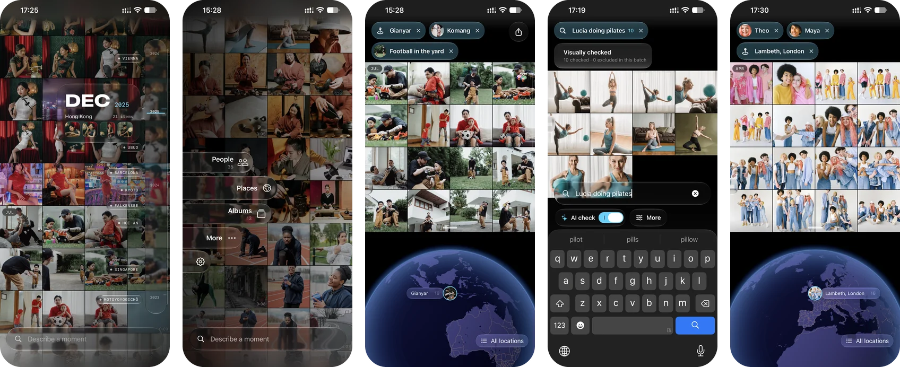

<p align="center">
  <br/>
  <a href="https://opensource.org/license/agpl-v3"></a>
  <a href="https://apps.apple.com/app/ilyich/id6833595725"></a>
  <br/>
  <br/>
</p>

<p align="center">

</p>
<h1 align="center">Ilyich</h1>
<h3 align="center">High performance self-hosted photo and video management solution</h3>
<br/>
<a href="https://apps.apple.com/app/ilyich/id6833595725">

</a>
<br/>

> [!NOTE]
> Ilyich is a fork of [Immich](https://github.com/immich-app/immich). It runs Immich's server and web app, adds the features marked ★ below, and has its own native iPhone app. Ilyich is not affiliated with or endorsed by Immich.

> [!IMPORTANT]
> Use the `dev` branch. `main` is an unchanged copy of Immich's latest stable release and contains none of Ilyich.

> [!WARNING]
> ⚠️ Always follow [3-2-1](https://www.backblaze.com/blog/the-3-2-1-backup-strategy/) backup plan for your precious photos and videos!

## Links

- [iPhone app on the App Store](https://apps.apple.com/app/ilyich/id6833595725)
- [Installation and administration](https://docs.immich.app/install/requirements) (Ilyich sets up like Immich; build the server from the `dev` branch)
- [Lightroom sidecar notes](docs/docs/features/xmp-sidecars.md)
- [iPhone app](#iphone-app)
- [Server](#server)
- [Features](#features)
- [Issues and support](https://github.com/ilyador/Ilyich/issues)
- [iPhone app privacy policy](ios-native/PRIVACY.md)

## iPhone app

Ilyich for iPhone is a native app written for iOS 27 in Liquid Glass, not a port of the Immich mobile app.

Your whole library is one feed. There are no tabs and no separate gallery: people, places, albums, videos and favorites are filters, and filters stack. Pick a person, add a place, add an album, and the feed narrows to what matches all of them.

- Swipe in from the left edge for the shelves: People, Places, Albums, More and Settings.
- Drag the time rail on the right edge to open a column of years and trips, with a lens on the month under your finger. The photos follow once it is open and stay where your finger stops.
- Places sit on a 3D Earth, by day or night with the system appearance. Pins start at cities, and every place belongs to one hierarchy, from continent down to neighborhood, shared by the Earth, the places list, search and the place names on each month.
- The viewer works like Apple Photos, with a thumbnail strip and a zoom out of the grid and back into it.
- The timeline, People and Albums work offline. Up to 1.5 GB of thumbnails stay on the phone (adjustable from 512 MB to 10 GB), and a video falls back to the matching copy in Apple Photos.
- Free up space removes a photo from the phone only after its backup on the server is verified, and checks again just before Photos removes it.
- Backup of the albums you choose, Live Photos, the Locked Folder behind Face ID, shared albums, partner libraries in the feed, memories, editing and shared links work as they do in Immich.

The app also works with stock Immich 3.3.0 and later. Lightroom previews and the AI check appear when it is connected to an Ilyich server. The App Store version is free to download; full access is a monthly or yearly subscription, with a free first week, or a one-time purchase.

## Server

- **Lightroom previews.** Ilyich renders the adjustments in a photo's Lightroom XMP sidecar onto the original with [Lightcraft](https://github.com/storytold/lightcraft) and caches the developed preview. The original and the sidecar stay untouched.
- **Natural-language search.** Search understands people, places and dates in a plain sentence, works out who does what in it, keeps an ambiguous name ambiguous, and matches regions, so "in Portugal" covers the whole country.
- **AI check.** An optional pass by a locally hosted model looks at each search result and keeps only the confirmed matches. Descriptive queries are checked automatically, and a partial check can be retried.
- **Faces in videos.** Faces are found across a whole video, not just its thumbnail frame, and each face's picture comes from the frame it was found in.

Lightroom previews and the AI check depend on how the server is configured.

## Features

★ marks what Ilyich adds to Immich.

| Features                                       | iPhone | Web |
| :--------------------------------------------- | ------ | --- |
| Upload and view videos and photos              | Yes    | Yes |
| Auto backup when the app is opened             | Yes    | N/A |
| Prevent duplication of assets                  | Yes    | Yes |
| Selective album(s) for backup                  | Yes    | N/A |
| Download photos and videos to local device     | Yes    | Yes |
| Multi-user support                             | Yes    | Yes |
| Album and Shared albums                        | Yes    | Yes |
| Scrubbable/draggable scrollbar                 | Yes    | Yes |
| Support raw formats                            | Yes    | Yes |
| ★ Lightroom edits rendered from XMP sidecars   | Yes    | Yes |
| ★ Lightroom collection                         | Yes    | No  |
| Metadata view (EXIF, map)                      | Yes    | Yes |
| Search by metadata, objects, faces, and CLIP   | Yes    | Yes |
| ★ Natural-language search                      | Yes    | Yes |
| ★ AI check of search results                   | Yes    | Yes |
| ★ One feed with stackable filters              | Yes    | No  |
| Administrative functions (user management)     | No     | Yes |
| Background backup                              | Yes    | N/A |
| Virtual scroll                                 | Yes    | Yes |
| OAuth support                                  | Yes    | Yes |
| API Keys                                       | N/A    | Yes |
| LivePhoto/MotionPhoto backup and playback      | Yes    | Yes |
| Support 360 degree image display               | No     | Yes |
| User-defined storage structure                 | Yes    | Yes |
| Public Sharing                                 | Yes    | Yes |
| Archive and Favorites                          | Yes    | Yes |
| Global Map                                     | Yes    | Yes |
| ★ 3D Earth and places hierarchy                | Yes    | No  |
| Partner Sharing                                | Yes    | Yes |
| Facial recognition and clustering              | Yes    | Yes |
| ★ Faces across whole videos                    | Yes    | Yes |
| Memories (x years ago)                         | Yes    | Yes |
| Offline support                                | Yes    | No  |
| ★ Free up space after a verified backup        | Yes    | N/A |
| Read-only gallery                              | Yes    | Yes |
| Stacked Photos                                 | Yes    | Yes |
| Tags                                           | Yes    | Yes |
| Folder View                                    | Yes    | Yes |

## Branches

- **`dev`** is Ilyich: the latest stable Immich release with the fork's work on top. Clone, build and run from it.
- **`main`** is a plain copy of the latest stable Immich release with no Ilyich changes. It exists only to track Immich; don't build from it.

```bash
git clone --branch dev https://github.com/ilyador/Ilyich.git
```

## Contributors

Ilyich builds on the work of the [Immich contributors](https://github.com/immich-app/immich/graphs/contributors). Original copyright and attribution notices are retained, and Ilyich is available under the [GNU AGPL v3 license](LICENSE).

<a href="https://github.com/immich-app/immich/graphs/contributors">
  
</a>
